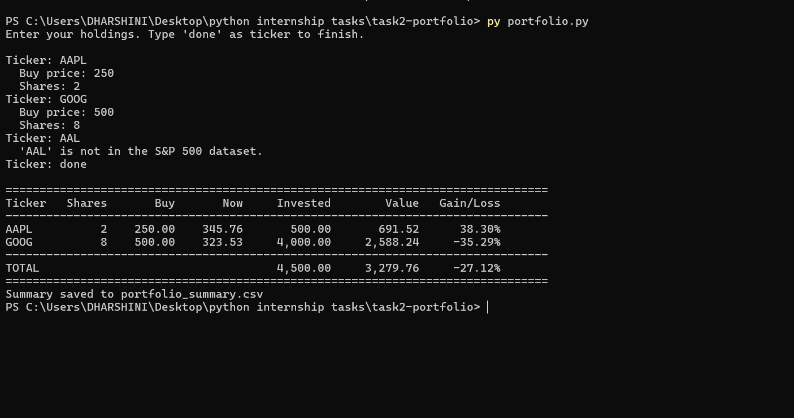

# Python Programming Internship – Datheon

A collection of Python projects built as part of the Datheon Python Programming Internship. Each task lives in its own folder with its own code, screenshots and run instructions.

## Tasks

| # | Task | Folder | Status |
|---|------|--------|--------|
| 1 | Hangman Word Guessing Game (Console + GUI) | [`task1-hangman`](task1-hangman) | Completed |
| 2 | Stock Portfolio Performance Tracker | [`task2-portfolio`](task2-portfolio) | Completed |

---

## Task 1 – Hangman Word Guessing Game

An interactive, modular Hangman game where the player guesses a hidden word letter by letter within 6 attempts. It comes in two versions:

- **`hangman.py`** – console (terminal) version with ASCII gallows art
- **`hangman_gui.py`** – bonus GUI version built with `tkinter`

### Features

- Random word selection using `random.choice()` from `words.txt`
- Masked word display (e.g. `_ a _ h e o n`)
- Correct and wrong guesses tracked using sets
- Maximum of 6 mistakes, with the gallows updating after each wrong guess
- Duplicate or invalid guesses are rejected and do **not** cost an attempt
- Clear win and game-over screens, with a play-again option
- GUI version: A–Z buttons, keyboard input, resizable and maximizable window

### Requirements

- Python 3.8 or later
- No external libraries (uses only the standard library: `random`, `os`, `tkinter`)

### Installation

```bash
git clone https://github.com/Dharshini-S-1511/Datheon_Python_Programming_Internship.git
cd Datheon_Python_Programming_Internship/task1-hangman
```

### How to run

Console version:

```bash
python hangman.py
```

GUI version:

```bash
python hangman_gui.py
```

> Keep `words.txt` in the same folder as the scripts. If it is missing, the game uses a small built-in word list.

### Project structure

```
task1-hangman/
├── hangman.py        # console game
├── hangman_gui.py    # tkinter GUI game
├── words.txt         # English word list
└── screenshots/      # win and lose screens
```

### Architecture

The code is split into small, single-purpose functions.

| Function | Purpose |
|----------|---------|
| `load_words()` | Reads `words.txt`, keeps alphabetic words of 4+ letters, falls back to a built-in list |
| `mask_word()` | Builds the masked display of the word |
| `draw()` | Clears the screen and shows the gallows, word, wrong letters and attempts left |
| `get_guess()` | Validates input and rejects duplicates |
| `play_round()` | Main game loop for one round |
| `main()` | Picks a random word and handles replaying |

The GUI version uses a `HangmanGUI` class. It draws the hangman on a `Canvas`, scales the drawing with the window size, and disables each letter button once it is used.

### Screenshots

| Version | Win | Lose |
|---------|-----|------|
| Console |  |  |
| GUI |  |  |

---

## Task 2 – Stock Portfolio Performance Tracker

A console utility that tracks the performance of an investment portfolio. The user enters stock tickers, buy prices and share quantities, and the program computes the total portfolio value and the percentage gain or loss per holding, then logs the results to a CSV file.

### Features

- Ticker symbols validated against the S&P 500 dataset (`sp500.csv`)
- Live market prices fetched with `yfinance`, with manual price entry as a fallback if the lookup fails or the machine is offline
- Positions stored in a dictionary; repeated entries for the same ticker are merged using a weighted-average buy price
- Calculates invested capital, current market value and percentage gain/loss per holding, plus portfolio totals
- Input validation for buy prices and share counts
- Formatted console table of results
- Every run is appended with a timestamp to `portfolio_summary.csv` using Python's built-in `csv` module

### Requirements

- Python 3.8 or later
- `yfinance` (optional but recommended, for live prices)

```bash
py -m pip install yfinance
```

### Installation

```bash
git clone https://github.com/Dharshini-S-1511/Datheon_Python_Programming_Internship.git
cd Datheon_Python_Programming_Internship/task2-portfolio
```

### How to run

```bash
python portfolio.py
```

Enter each holding when prompted (ticker, buy price, shares). Type `done` as the ticker to finish and see the report.

> Keep `sp500.csv` in the same folder as the script. If it is missing, ticker validation is skipped.

### Project structure

```
task2-portfolio/
├── portfolio.py           # main program
├── sp500.csv              # S&P 500 ticker dataset
├── portfolio_summary.csv  # generated log of each run
└── screenshots/           # sample output
```

### Architecture

| Function | Purpose |
|----------|---------|
| `load_tickers()` | Reads `sp500.csv` into a symbol-to-company dictionary |
| `read_positive()` | Prompts until the user enters a valid positive number |
| `get_price()` | Fetches the live price with `yfinance`, or asks the user if it fails |
| `collect_portfolio()` | Gathers holdings and stores them in a dictionary |
| `analyse()` | Computes invested amount, current value and gain/loss % |
| `print_report()` | Prints the formatted results table and totals |
| `save_summary()` | Appends the results to `portfolio_summary.csv` |
| `main()` | Runs the full workflow |

### Screenshots

| Console output |
|----------------|
|  |


## Author

**Dharshini**
Computer Science student
GitHub: [Dharshini-S-1511](https://github.com/Dharshini-S-1511)
