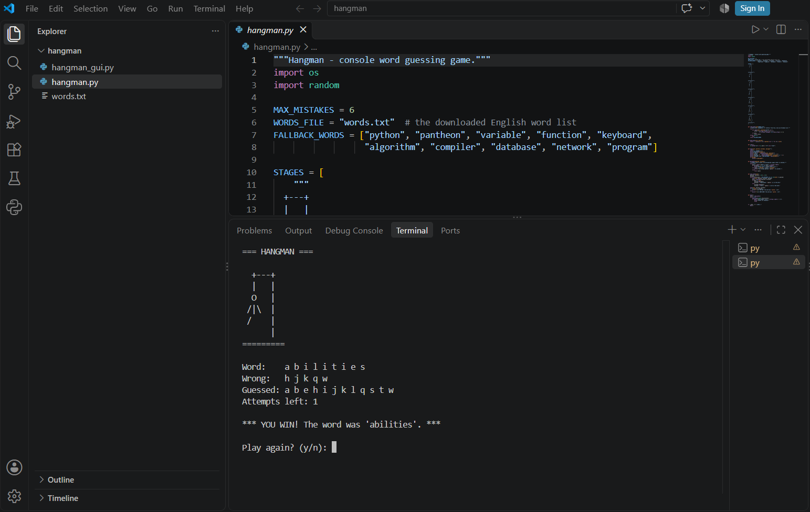
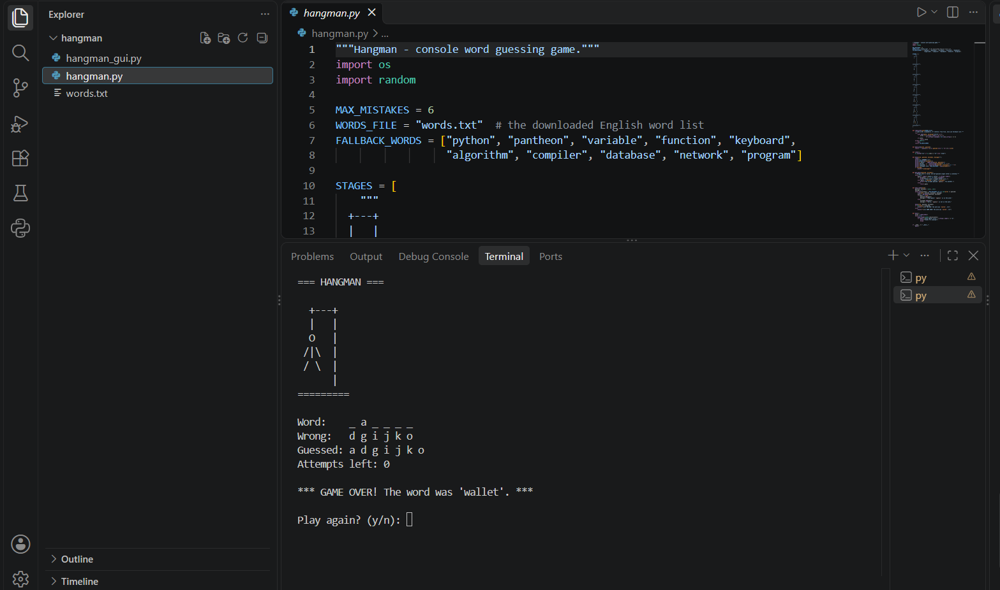
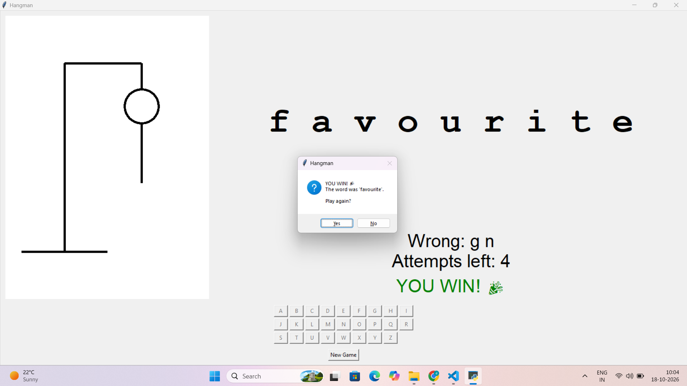
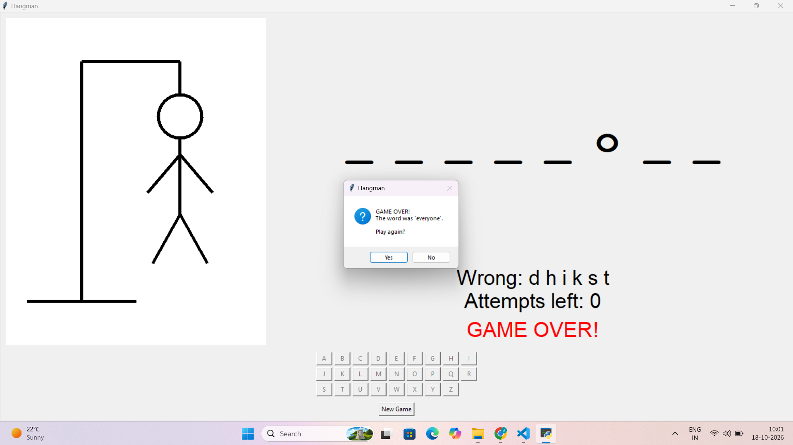

# Python Programming Internship – Datheon

A collection of Python projects built as part of the Datheon Python Programming Internship. Each task lives in its own folder with its own code, screenshots and run instructions.

## Tasks

| # | Task | Folder | Status |
|---|------|--------|--------|
| 1 | Hangman Word Guessing Game (Console + GUI) | [`task1-hangman`](task1-hangman) | Completed |
| 2 | Stock Portfolio Performance Tracker | `task2-...` | In progress |

---

## Task 1 – Hangman Word Guessing Game

An interactive, modular Hangman game where the player guesses a hidden word letter by letter within 6 attempts. It comes in two versions:

- **`hangman.py`** – console (terminal) version with ASCII gallows art
- **`hangman_gui.py`** – bonus GUI version built with `tkinter`

### Features

- Random word selection using `random.choice()` from `words.txt`
- Masked word display (e.g. `_ a _ h e o n`)
- Correct and wrong guesses tracked using sets
- Maximum of 6 mistakes, with the gallows updating after each wrong guess
- Duplicate or invalid guesses are rejected and do **not** cost an attempt
- Clear win and game-over screens, with a play-again option
- GUI version: A–Z buttons, keyboard input, resizable and maximizable window

### Requirements

- Python 3.8 or later
- No external libraries (uses only the standard library: `random`, `os`, `tkinter`)

### Installation

```bash
git clone https://github.com/YOUR-USERNAME/python-internship-tasks.git
cd python-internship-tasks/task1-hangman
```

### How to run

Console version:

```bash
python hangman.py
```

GUI version:

```bash
python hangman_gui.py
```

> Keep `words.txt` in the same folder as the scripts. If it is missing, the game uses a small built-in word list.

### Project structure

```
task1-hangman/
├── hangman.py        # console game
├── hangman_gui.py    # tkinter GUI game
├── words.txt         # English word list
└── screenshots/      # win and lose screens
```

### Architecture

The code is split into small, single-purpose functions.

| Function | Purpose |
|----------|---------|
| `load_words()` | Reads `words.txt`, keeps alphabetic words of 4+ letters, falls back to a built-in list |
| `mask_word()` | Builds the masked display of the word |
| `draw()` | Clears the screen and shows the gallows, word, wrong letters and attempts left |
| `get_guess()` | Validates input and rejects duplicates |
| `play_round()` | Main game loop for one round |
| `main()` | Picks a random word and handles replaying |

The GUI version uses a `HangmanGUI` class. It draws the hangman on a `Canvas`, scales the drawing with the window size, and disables each letter button once it is used.

### Screenshots

| Version | Win | Lose |
|---------|-----|------|
| Console |  |  |
| GUI |  |  |

> Rename your screenshot files to match these names, or edit the paths above.

---

## Author

**Dharshini**
Computer Science student
GitHub: [Dharshini-S-1511](https://github.com/Dharshini-S-1511)
